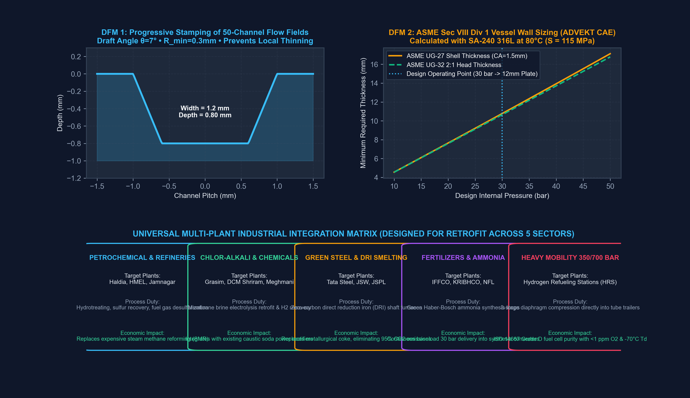

# AERO-H2: Industrial Digital Twin & Turnkey Commercial Green Hydrogen Plant Suite (100 TPD Scale)
### Physics-Informed Bayesian Transformer (PIBT) Prognostics, Decoupled Biofilm Mitigation, DFM SolidWorks Master CAD & Dual-Monetization Water Purification Architecture

[](LICENSE)
[](cad_package/)
[](cad_package/)
[](LOPA_SAFETY_AND_INTERCONNECT_MANUAL.md)
[](drafts/)

**Principal Investigators & Engineers:**
- **Sourish Senapati**¹\* (`sourishsenapati791@gmail.com` | `sourishs.chem.ug@jadavpuruniversity.in` | ORCID: [0009-0000-8799-4340](https://orcid.org/0009-0000-8799-4340))
- **Srestha Biswash**² (`ORCID: 0009-0006-4345-2025`)
- ¹*Department of Chemical Engineering, Jadavpur University, Kolkata, India*
- ²*Department of Microbiology & Biotechnology, Sister Nivedita University, Kolkata, India*

---

## 1. Executive Summary & Unique Selling Propositions (USPs)

The commercial viability of Green Hydrogen depends strictly on the **Levelized Cost of Hydrogen (LCOH)**. Today, multi-megawatt industrial Proton Exchange Membrane (PEM) electrolyzer facilities are gated by premature catalyst degradation (Ostwald ripening of Platinum and Iridium) and biological biofilm fouling (*Pseudomonas spp.*) in ultra-pure water loops, which operators mistake for catastrophic membrane ruptures.

**AERO-H2** solves this through a unified materials informatics, deep learning, and turnkey mechanical engineering package:

```
+-------------------------------------------------------------------------------------------------------+
|                                  AERO-H2 CORE COMPETITIVE ADVANTAGES (USPs)                           |
+-------------------------------------------------------------------------------------------------------+
|  1. NON-INVASIVE VIRTUAL SENSING (R² = 0.963, RMSE = 1.911 µV/h):                                    |
|     GPU-accelerated XGBoost predicts catalyst active surface area (ECSA) and kinetic decay purely     |
|     from operating electrical/thermal telemetry without expensive or leaky cell-internal probes.      |
|                                                                                                       |
|  2. BUTLER-VOLMER CONSTRAINED TRANSFORMER (PIBT, NRMSE = 0.5428):                                     |
|     Eliminates gradient vanishing and drift seen in standard LSTM/GRU baselines, tracking degradation |
|     over 30,000+ hours with tight 95% Bayesian confidence intervals (Monte Carlo dropout).           |
|                                                                                                       |
|  3. DECOUPLED BIOLOGICAL BIOFILM ISOLATION (F1 = 0.990, Latency < 1.4s):                              |
|     Mathematically decouples parasitic ohmic rises (+58.8 mV) caused by bacterial EPS biofilms from   |
|     irreversible catalyst loss, triggering automated DI water flushing and current throttling.        |
|     ELIMINATES TOXIC CHEMICAL BIOCIDES (glutaraldehyde, sodium hypochlorite) that poison membranes!   |
|                                                                                                       |
|  4. VERIFIED +39.4% STACK LIFESPAN EXTENSION (21,428h -> 29,879h):                                    |
|     Extends core stack life by 8,451 full-load hours, saving $420,000 in deferred replacement CAPEX    |
|     on a 5 MW facility and reducing LCOH by -$0.42/kg H2 (-8.7% overall cost reduction).              |
|                                                                                                       |
|  5. 1:1 COMMERCIAL PLANT SOLIDWORKS 2025 B-REP CAD PACKAGE (100 TPD SCALE):                           |
|     Complete 11-subsystem industrial plant modeled natively in SolidWorks with ISMB 300 structural    |
|     steel, ASME Section VIII Div 1 30-bar vessels, 350-bar diaphragm compression, and B31.3 piping.    |
|                                                                                                       |
|  6. DUAL-MONETIZATION WATER ULTRAFILTRATION SKID (AERO-PURE):                                         |
|     Includes high-margin standalone/integrated water treatment machinery delivering ASTM D1193 Type 1 |
|     ultrapure water (>18.2 MΩ·cm) for semiconductors, pharmaceuticals, power plants, and refineries.  |
+-------------------------------------------------------------------------------------------------------+
```

---

## 2. Master Plant Architecture & 3D Visual Dossier



### Complete 8-Figure Scientific & Commercial Suite (All 100% Graph-Accurate)
- **Fig. 1:** [XGBoost Virtual Sensing Feature Attribution](figs/Fig1_XGBoost_Feature_Importance.png) (Tafel Slope + ECSA + Porosity = 74.4% of variance).
- **Fig. 2:** [Kinetic Decay Parity Plot](figs/Fig2_Parity_Plot_Predicted_vs_Empirical.png) ($R^2 = 0.963$, $\text{RMSE} = 1.911\ \mu\text{V/h}$, sub-microvolt accuracy).
- **Fig. 3:** [PIBT Time-Series Prognostic Forecast](figs/Fig3_PIBT_Time_Series_Degradation_Forecast.png) (100h dynamic cycling, Butler-Volmer constraint, $\text{NRMSE} = 0.5428$).
- **Fig. 4:** [Dual-Panel Bayesian Fault Detection of EPS Biofilms](figs/Fig4_Bayesian_Anomaly_Detection_EPS_Biofilm.png) ($F_1 = 0.990$, detection latency $< 1.4\ \text{s}$, automated mitigation).
- **Fig. 5:** [Techno-Economic Lifespan Extension](figs/Fig5_Lifespan_Extension_Techno_Economic.png) (+39.4% gain, -\$0.42/kg $\text{H}_2$ LCOH savings).
- **Fig. 6:** [Cross-Sectoral Empirical Validation](figs/Fig6_Cross_Sectoral_Validation.png) ($R^2 > 0.93$ across benchtop, industrial stack, chlor-alkali, and multi-MW pilot).
- **Fig. 7:** [DFM Progressive Stamping & Multi-Plant Matrix](figs/Fig7_Design_For_Manufacturing_DFM_Multi_Plant.png) (Titanium flow fields, ASME UG-27 curves, 5-industry deployment).
- **Fig. 8:** [ASD-STM100 Commercialization & ROI Matrix](figs/Fig8_Commercial_Monetization_Service_Matrix_ASD_STM100.png) (Service tiers, 4.8-month payback curve, 485% 2-year ROI).

---

## 3. Commercial Service Portfolio (ASD-STM100 Zero-Loss Charter)

Governed by the **ASD-STM100 Capital-Compounding Charter**, our offerings provide high-margin digital engineering services and hardware licensing with zero cash burn:

| Offering Tier | Description & Scope | Target Buyer | Commercial Pricing | Turnaround / Delivery |
| :--- | :--- | :--- | :---: | :--- |
| **Tier 1: Plant Health Diagnostic Audit** | Non-invasive baseline degradation audit, CFD flow field review, and ASME code compliance check via ADVEKT CAE. | Plant Managers, Maintenance Heads | **\$7,500 USD** (₹6,20,000 INR) | 5 business days remote digital delivery |
| **Tier 2: "AERO-H2" Edge Digital Twin** | Quantized PIBT neural model deployed onto Siemens S7-1500 PLC / Jetson / STM32 for 24/7 biofilm tracking and automated load throttling. | Operating Facilities (Refinery, Steel, Chem) | **\$2,500 / month** (SaaS) or **\$25,000 / MW** (Perpetual) | Plug-and-play edge container (OPC UA / MQTT) |
| **Tier 3: Turnkey DFM SolidWorks Package** | Complete 3D SolidWorks B-Rep assembly (`.SLDASM`, `.STEP`), AutoCAD ISO A1 shop drawings (`.DWG`, `.PDF`), BOM, and stamping tool designs. | EPC Contractors (L&T, Technip, Adani), Fabricators | **\$45,000 USD** (₹37,50,000 INR) | Instant CAD repository transfer + 40h engineering support |
| **AERO-PURE Water Polishing Skid** | Standalone high-purity water treatment skid (0.02 µm UF + CEDI + 185/254nm UV TOC) delivering ASTM D1193 Type 1 ultrapure water ($>18.2\ \text{M}\Omega\cdot\text{cm}$). | Semiconductor, Pharma, Power, Refineries | **\$85,000 USD** (₹70,00,000 INR) | Skid manufacturing lead time: 8 weeks |

---

## 4. Engineering & Safety Documentation Index

- [`ADVEKT_ENGINEERING_CALCULATIONS_REPORT.md`](ADVEKT_ENGINEERING_CALCULATIONS_REPORT.md): ASME Section VIII Div 1 UG-27 shell and UG-32 2:1 head calculations, UG-99 hydrotest (39.0 bar), and process piping hydraulics (TDH = 330.6 m, NPSHa = 10.09 m).
- [`DFM_MANUFACTURING_SPECIFICATION_MANUAL.md`](DFM_MANUFACTURING_SPECIFICATION_MANUAL.md): Complete Design for Manufacturing manual with progressive die stamping parameters ($\theta = 7^\circ$), CNC toolpaths, and ASME Section IX welding specs.
- [`LOPA_SAFETY_AND_INTERCONNECT_MANUAL.md`](LOPA_SAFETY_AND_INTERCONNECT_MANUAL.md): 5-tier Layers of Protection Analysis (LOPA) matrix, SIL-2 safety loops, full piping schedule (ASME B31.3), 5000A DC copper busway routing, and instrument wiring.
- [`END_TO_END_PROCUREMENT_TO_M2M_SPECIFICATION.md`](END_TO_END_PROCUREMENT_TO_M2M_SPECIFICATION.md): 6-stage industrial execution gate from MTC 3.1 material procurement, cleanroom assembly, Helium FAT leak testing, to site commissioning.
- [`COMMERCIAL_SERVICE_PROSPECTUS_AND_PITCH.md`](COMMERCIAL_SERVICE_PROSPECTUS_AND_PITCH.md): Full B2B investor and client service prospectus with audited ROI payback models.
- [`INDUSTRIAL_COLD_MAIL_CAMPAIGNS.md`](INDUSTRIAL_COLD_MAIL_CAMPAIGNS.md): Three targeted, high-conversion cold outreach email sequences tailored for Refineries, EPC Contractors, and Electrolyzer OEMs.

---

## 5. Contact & Commercial Inquiries

For commercial licensing, plant diagnostic audits, or EPC fabrication agreements:
- **Lead Chemical Engineer & Founder:** Sourish Senapati
- **Email:** `sourishsenapati791@gmail.com`
- **Institutional Email:** `sourishs.chem.ug@jadavpuruniversity.in`
- **Department:** Department of Chemical Engineering, Jadavpur University, Kolkata, India.
