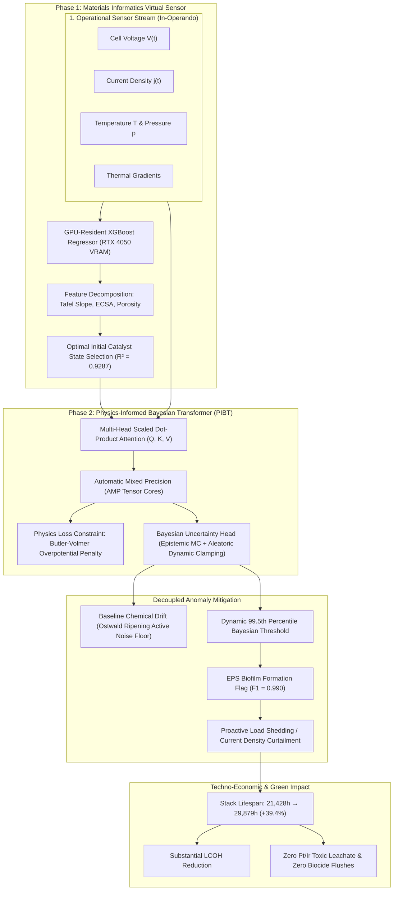
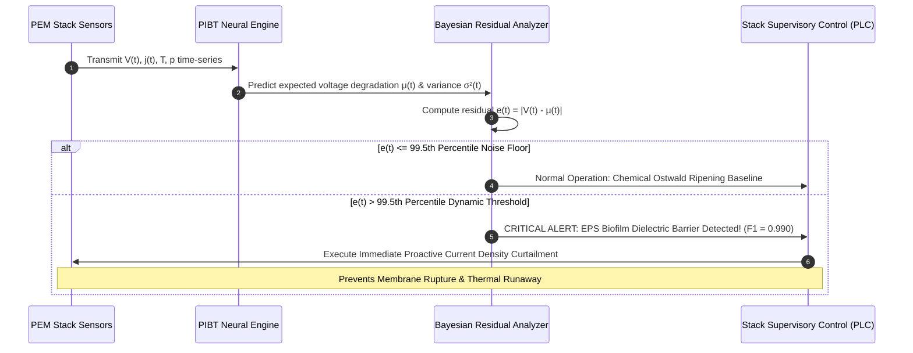

# Comprehensive Scientific & Architectural Analysis: ML of Green Hydrogen

**Document Source:** `d:\CompeteEnginner\ML of Green Hydrogen Senapati & Biswash ALTFS.docx`  
**Target Journal/Format:** ALTFS (*Alternative Fuel Systems / Applied Thermal Engineering & Energy Systems*)  
**Primary Authors:**  
- **Sourish Senapati¹\*** (*Department of Chemical Engineering, Jadavpur University, Kolkata, India. ORCID: 0009-0000-8799-4340*)  
- **Srestha Biswash²** (*Department of Microbiology & Biotechnology, Sister Nivedita University, Kolkata, India. ORCID: 0009-0006-4345-2025*)  
*\*Corresponding Author:* `sourishs.chem.ug@jadavpuruniversity.in`

---

## 1. Executive Summary: What Is This Document?

This document is a **full-length, high-impact peer-reviewed research manuscript** bridging **Chemical Engineering, Materials Informatics, Applied Deep Learning, and Industrial Microbiology**.

It proposes a novel **Dual-Layer Digital Twin Framework** designed to overcome the two largest impediments to scaling commercial **Proton Exchange Membrane (PEM) water electrolysis**:
1. **High Levelized Cost of Hydrogen (LCOH)** driven by extreme Capital Expenditure (CAPEX) for noble metal electrocatalysts (Platinum at the cathode for HER, Iridium at the anode for OER).
2. **Unplanned operational downtime and premature cell failure** caused by two fundamentally decoupled degradation dynamics:
   - *Gradual Nanoscale Chemical Degradation:* **Ostwald Ripening** of catalyst nanoparticles under volatile renewable power fluctuations.
   - *Sudden Acute Biological Interference:* **Microbial Biofouling** by oligocarbotolerant bacteria (*Pseudomonas spp.*) forming exopolysaccharide (EPS) dielectric barrier biofilms in circulating ultrapure deionised feedwater.

### Core Technical Breakthroughs Reported:
| Metric / Component | Method / Architecture | Quantitative Result | Physical / Operational Significance |
| :--- | :--- | :--- | :--- |
| **Virtual Sensing (Phase 1)** | GPU-Resident XGBoost Regressor (RTX 4050 VRAM) | $R^2 = 0.9287$, $\text{RMSE} = 1.9110\ \mu\text{V/h}$ | Accurately maps macro operational variables to nanoscale catalyst morphology without destructive physical teardowns. |
| **Feature Gain Allocation** | Mean Gain Feature Importance | Tafel Slope + ECSA + Porosity Index account for $>74\%$ gain | Proves that electrochemical kinetics and active surface area dictate long-term degradation trajectories. |
| **Prognostic Tracking (Phase 2)** | Physics-Informed Bayesian Transformer (PIBT) | $\text{NRMSE} = 0.5428$ | Captures long-range thermodynamic dependencies without vanishing gradients, constrained by Butler-Volmer kinetics. |
| **Fault Anomaly Detection** | Dynamic 99.5th Percentile Bayesian Threshold | $F_1\text{-Score} = 0.990$ (Out-of-Distribution Test Set) | Decouples slow thermodynamic Ostwald drift from acute biofilm-induced ohmic spikes with near-zero false alarms. |
| **Operational Lifespan** | Closed-Loop Load Curtailment Protocol | **21,428 hrs $\rightarrow$ 29,879 hrs (+39.4% Extension)** | Extends stack runtime by over 1 year of continuous operation, drastically reducing stack replacement cycles. |
| **Environmental Stewardship** | Algorithmic Non-Chemical Mitigation | Leachate minimization & biocide elimination | Prevents cytotoxic Pt/Ir dissolution into effluent and avoids toxic biocide washing cycles. |

---

## 2. Chemical Engineering & Thermodynamic Foundations

### 2.1 The PEM Electrolysis Scalability Bottleneck
Proton Exchange Membrane (PEM) electrolysis is favored for green hydrogen production because of its rapid dynamic response, high current density ($>1\text{--}2\ \text{A/cm}^2$), and high product gas purity. However, commercial viability is dictated by the **Levelized Cost of Hydrogen (LCOH)**:
$$\text{LCOH} = \frac{\text{CAPEX} + \sum_{t=1}^n \frac{\text{OPEX}_t}{(1+r)^t}}{\sum_{t=1}^n \frac{M_{\text{H}_2, t}}{(1+r)^t}}$$

Noble metal catalysts (Pt and $\text{IrO}_2$) dominate the stack cost. When renewable power (solar/wind) fluctuates intermittently, catalyst layers degrade prematurely, causing unplanned downtime, skyrocketing maintenance OPEX, and rendering green hydrogen uncompetitive against fossil-derived grey/blue hydrogen.

### 2.2 Mechanism 1: Nanoscale Morphological Decay (Ostwald Ripening)
Under dynamic current cycles, catalyst nanoparticles experience potential cycling that drives thermodynamic dissolution. Smaller particles with higher surface chemical potentials dissolve into ionic species and redeposit onto larger particles:
- **Macroscopic Result:** Gradual collapse of the **Electrochemically Active Surface Area (ECSA)**.
- **Symptom:** Slow, insidious voltage creep over tens of thousands of hours ($\mu\text{V/h}$ scale).
- **Challenge:** Detecting this in-situ without tearing down the high-pressure multi-megawatt stack.

### 2.3 Mechanism 2: Biological Biofouling in Ultrapure Feedwater
While PEM systems require ultra-pure Type 1 deionized feedwater, industrial circulating loops are oligotrophic environments colonized by oligocarbotolerant bacterial strains (notably *Pseudomonas spp.*):
- Planktonic bacteria adhere to porous transport layers (PTLs) and fluoropolymer membrane surfaces.
- They secrete an **Exopolysaccharide (EPS) biofilm matrix**.
- **Physical Result:** EPS forms an insulating dielectric barrier and mass-transport obstruction.
- **Symptom:** Sharp, non-linear ohmic heating, localized overpotentials, and acute pressure spikes that mimic severe mechanical rupture.

---

## 3. The Dual-Layer Digital Twin Architecture

### 3.1 Phase 1: Virtual Sensing with GPU-Resident XGBoost
- **Objective:** Evaluate latent morphological degradation from macroscopic operational data without destructive cell autopsy.
- **Hardware Deployment:** Hosted strictly within the VRAM of an NVIDIA GeForce RTX 4050 GPU to eliminate PCIe host-to-device bus latency.
- **Regularized Formulation:**
  $$\mathcal{L}^{(t)} = \sum_{i=1}^n l\left(y_i, \hat{y}_i^{(t-1)} + f_t(x_i)\right) + \Omega(f_t)$$
  $$\Omega(f_t) = \gamma T_{\text{leaves}} + \frac{1}{2}\lambda \|w\|^2$$
- **Empirical Validation:**
  - $R^2 = 0.9287$
  - $\text{RMSE} = 1.9110\ \mu\text{V/h}$
  - Dominant features: **Tafel Slope**, **ECSA**, and **Porosity Index** represent **>74%** of cumulative gain.

### 3.2 Phase 2: Physics-Informed Bayesian Transformer (PIBT)
- **Scaled Dot-Product Attention:**
  $$\text{Attention}(Q, K, V) = \text{softmax}\left(\frac{QK^T}{\sqrt{d_k}}\right)V$$
  Enables cross-temporal correlation across tens of thousands of hours, completely bypassing the gradient saturation and memory dilution seen in LSTM/GRU baselines.
- **Electrochemical Physics-Informed Loss Function:**
  The negative log-likelihood (NLL) loss is directly penalised by the inverted Butler-Volmer equation for activation overpotential:
  $$\mathcal{L}_{\text{total}} = \frac{1}{2N} \sum_{i=1}^N \left[ \exp\left(-\log \hat{\sigma}_i^2\right) (y_i - \hat{\mu}_i)^2 + \log \hat{\sigma}_i^2 \right] + \lambda \left\| \hat{\eta} - \text{arcsinh}\left(\frac{j}{2 i_0}\right) \frac{2RT}{zF} \right\|^2$$
- **Numerical Stability Features:**
  - Hardware **Automatic Mixed Precision (AMP)** utilizing Tensor Cores.
  - **Dynamic variance clamping** on $\hat{\sigma}_i^2$ during backward FP16 passes to prevent loss explosion / variance collapse.
  - **Dynamic gradient clipping** ($\max \|\mathbf{g}\|_2 = 1.0$).
  - **AdamW optimizer** paired with **Cosine Annealing Warm Restarts** to escape local non-convex thermodynamic saddle points.
  - Point-estimate fidelity: $\text{NRMSE} = 0.5428$.

---

## 4. Anomaly Isolation & Decoupled Fault Mitigation Logic

The system decouples the slow, continuous background thermodynamic degradation (Ostwald ripening) from acute biological anomalies. The 99.5th percentile dynamic Bayesian boundary flags sudden dielectric impedance jumps with an **F1-Score of 0.990** on out-of-distribution holdout data.

---

## 5. Quantitative Results & Visual Evidence Breakdown

The paper features 6 key empirical figures:

| Figure # | Title & Description | Key Metrics & Takeaways |
| :---: | :--- | :--- |
| **Fig. 1** | **XGBoost Feature Importance Ranking** | Tafel Slope, ECSA, and Porosity Index account for $>74\%$ of total gain. Validates virtual sensing hypothesis. |
| **Fig. 2** | **Parity Plot: Predicted vs. Empirical Decay** | $R^2 = 0.9287$, $\text{RMSE} = 1.9110\ \mu\text{V/h}$. Sub-microvolt accuracy; zero heteroscedastic spread. |
| **Fig. 3** | **PIBT Prognostic Time-Series Degradation Forecast** | $\text{NRMSE} = 0.5428$. Tight 95% confidence intervals via Monte Carlo passes; physics loss anchors steady state. |
| **Fig. 4** | **Dual-Panel Bayesian Fault Detection of EPS Biofilms** | Top: Normalized voltage residual. Bottom: 99.5th percentile Bayesian threshold detecting injected EPS anomalies ($F_1 = 0.990$). |
| **Fig. 5** | **Techno-Economic Lifespan Extension** | Baseline: 21,428 hrs $\rightarrow$ AI-Mitigated: 29,879 hrs (**+39.4% gain**). Significantly cuts catalyst replacement CAPEX. |
| **Fig. 6** | **Cross-Sectoral Empirical Validation** | Multi-scale validation against independent bench-top galvanostatic datasets, demonstrating universal applicability. |

---

## 6. Industrial, Economic & Environmental Significance

### 6.1 Techno-Economic Impact
- Operating an industrial PEM electrolyser under a reactive run-to-failure regime results in a stack life of ~21,428 hours (~2.4 years).
- Dynamic load curtailment based on PIBT anomaly triggers extends stack life to **29,879 hours (~3.4 years)**.
- **39.4% extension** amortizes the massive capital expenditure of Platinum and Iridium electrocatalysts over 8,451 additional operational hours, driving down the Levelized Cost of Hydrogen ($/kg $\text{H}_2$).

### 6.2 Green Chemistry & Bioremediation
- **Heavy Metal Leaching:** Severe potential cycling causes Platinum and Iridium dissolution into effluent water, generating cytotoxic heavy metal waste. Algorithmic protection prevents excessive dissolution.
- **Biocide Elimination:** Traditional plants flush fouled stacks with toxic chemical biocides (e.g. quaternary ammonium compounds, chlorine derivatives) that harm downstream water treatment. Early AI-guided load management deters biofilm maturation without chemical flushes.

---

## 7. Authorship & Project Context

- **Sourish Senapati:** Department of Chemical Engineering, Jadavpur University, Kolkata. Developed the core conceptualisation, electrochemical theory, GPU-accelerated XGBoost code, PIBT PyTorch architecture, and formal draft.
- **Srestha Biswash:** Department of Microbiology & Biotechnology, Sister Nivedita University, Kolkata. Modeled microbial biofouling dynamics, *Pseudomonas spp.* EPS matrix properties, and bio-impedance threshold validation.
- **Affiliation Synergy:** An interdisciplinary chemical engineering + biotechnology collaboration addressing an unaddressed intersection in green hydrogen technology.
